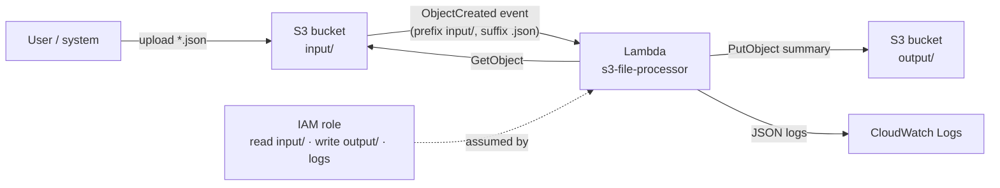

# aws-s3-lambda-file-processor

Serverless, event-driven file processing with **Amazon S3** and **AWS Lambda**.

Drop a JSON file of transactions into an S3 bucket and a Lambda function automatically
validates it, summarizes it, and writes the result back to S3. Every run is logged to
**CloudWatch** as structured JSON.

## Purpose

This project is a hands-on deliverable for the goal *"Explore and enhance Cloud skills in AWS
Services"*. It demonstrates, end to end and running on the AWS Free Tier:

- **Event-driven architecture**: S3 `ObjectCreated` events invoke Lambda with no servers or polling.
- **Serverless compute**: Python 3.13 Lambda function.
- **IAM least privilege**: the function can only read `input/`, write `output/`, and write its logs.
- **Monitoring**: structured JSON logs in CloudWatch, including duration and memory per run.
- **Defensive processing**: invalid files produce a clear `FAILED` report instead of a crash.
- **Infrastructure from the CLI**: repeatable deploy, demo, and teardown scripts.

## Architecture



1. A file such as `transactions.json` is uploaded to `s3://<bucket>/input/`.
2. S3 sends an `ObjectCreated` event to the Lambda function.
3. The function downloads the file, validates every transaction, and computes a summary.
4. It writes `output/<name>.summary.json` with status `PROCESSED` or `FAILED`.
5. CloudWatch records the run (INFO for processed files, ERROR for rejected ones).

### Example

Input `input/transactions.json`:

```json
[
  { "id": 1, "customer": "John", "amount": 150 },
  { "id": 2, "customer": "Mary", "amount": 250 },
  { "id": 3, "customer": "Peter", "amount": 100 }
]
```

Output `output/transactions.summary.json`:

```json
{
  "status": "PROCESSED",
  "total_transactions": 3,
  "total_amount": 500,
  "average_amount": 166.67,
  "source_file": "s3://ccog-file-processor-<ACCOUNT_ID>/input/transactions.json",
  "processed_at": "2026-11-21T20:33:55+00:00"
}
```

A file with problems is reported, not silently dropped. Every problem is listed:

```json
{
  "status": "FAILED",
  "errors": [
    "Transaction 2: missing field 'customer'",
    "Transaction 3: 'amount' must be a number"
  ],
  "source_file": "s3://ccog-file-processor-<ACCOUNT_ID>/input/missing-fields.json",
  "processed_at": "2026-11-21T20:33:45+00:00"
}
```

Validation rules: the file must be UTF-8 JSON containing a non-empty array; each transaction
must be an object with `id`, `customer` and `amount`; `amount` must be a finite number.
Transactions are referred to by their position in the file.

## Project structure

```
aws-s3-lambda-file-processor/
├── src/
│   ├── handler.py          # Lambda entry point: S3 event -> read file -> write summary -> log
│   └── processor.py        # Pure validation/summary logic (no AWS dependencies)
├── tests/
│   └── test_processor.py   # Unit tests for the processing logic (stdlib unittest)
├── sample-data/
│   ├── transactions.json   # Valid file -> PROCESSED
│   ├── invalid-json.json   # Malformed JSON -> FAILED
│   └── missing-fields.json # Missing/invalid fields -> FAILED
├── infra/
│   ├── common.ps1          # Shared names and AWS CLI helpers
│   ├── deploy.ps1          # Creates/updates bucket, IAM role, Lambda, S3 trigger
│   ├── demo.ps1            # Uploads the samples and captures evidence
│   ├── teardown.ps1        # Deletes every resource created by deploy.ps1
│   └── trust-policy.json   # Lets the Lambda service assume the IAM role
└── evidence/               # Proof the system works (see "Evidence" below)
```

`processor.py` holds the business rules and `handler.py` only deals with AWS. That split
keeps the rules testable on any laptop without AWS credentials.

## AWS resources

| Resource | Name | Purpose |
|---|---|---|
| S3 bucket | `ccog-file-processor-<account-id>` | `input/` for uploads, `output/` for summaries. Private and SSE-S3 encrypted by default |
| Lambda function | `s3-file-processor` | Python 3.13, 128 MB, 30 s timeout, JSON log format |
| IAM role | `s3-file-processor-role` | `AWSLambdaBasicExecutionRole` + inline `s3:GetObject` on `input/*` and `s3:PutObject` on `output/*` |
| Lambda permission | `s3-invoke` | Only this bucket in this account can invoke the function |
| S3 event notification | `process-input-json` | `s3:ObjectCreated:*`, prefix `input/`, suffix `.json` |
| CloudWatch log group | `/aws/lambda/s3-file-processor` | Created automatically by Lambda |

## Running it

Prerequisites: AWS CLI v2, PowerShell, Python 3.10+ (for the unit tests), and an AWS CLI
profile for the target account. The scripts default to profile `ccog-personal` in
`us-east-1`; override with `-AwsProfile` and `-Region`.

```powershell
# Unit tests (no AWS needed)
python -m unittest discover -s tests -v

# Deploy (safe to re-run: reuses existing resources and updates the code)
.\infra\deploy.ps1

# Demo: upload all sample files, wait for the summaries, save evidence/
.\infra\demo.ps1

# Try it by hand
aws s3 cp sample-data\transactions.json s3://ccog-file-processor-<account-id>/input/ --profile ccog-personal
aws s3 cp s3://ccog-file-processor-<account-id>/output/transactions.summary.json - --profile ccog-personal

# Remove everything when finished
.\infra\teardown.ps1
```

## Evidence

Captured from a real run in AWS on 2026-11-21 (account ID redacted as `<ACCOUNT_ID>`):

| File | Shows |
|---|---|
| [evidence/unit-tests.txt](evidence/unit-tests.txt) | 7/7 unit tests passing |
| [evidence/output/transactions.summary.json](evidence/output/transactions.summary.json) | Valid file summarized: 3 transactions, total 500, average 166.67 |
| [evidence/output/invalid-json.summary.json](evidence/output/invalid-json.summary.json) | Malformed JSON rejected |
| [evidence/output/missing-fields.summary.json](evidence/output/missing-fields.summary.json) | Missing `customer` and non-numeric `amount` both reported |
| [evidence/cloudwatch-logs.json](evidence/cloudwatch-logs.json) | CloudWatch logs: exactly one invocation per upload, INFO/ERROR levels, cold start ~490 ms, warm runs ~260 ms, ~93 MB memory |
| [evidence/screenshots/](evidence/screenshots/) | AWS console screenshots (see list below) |

Console screenshots `evidence/screenshots/`:

1. [s3-bucket.png](evidence/screenshots/1.%20s3-bucket.png): the bucket showing the `input/` and `output/` folders.
2. [lambda-trigger.png](evidence/screenshots/2.%20lambda-trigger.png): the Lambda function overview with the S3 trigger attached.
3. [lambda-monitor.png](evidence/screenshots/3.%20lambda-monitor.png): the Lambda *Monitor* tab showing the invocations.
4. [cloudwatch-logs.png](evidence/screenshots/4.%20cloudwatch-logs.png): a log stream with the `File PROCESSED` and `File FAILED` entries.
5. [iam-role.png](evidence/screenshots/5.%20iam-role.png): the role's inline policy scoped to `input/*` and `output/*`.

## Design decisions

- **One bucket, two prefixes, filtered trigger.** The trigger only fires for `input/*.json`, so
  the function writing to `output/` can never invoke itself. A self-triggering loop is the
  classic S3 + Lambda billing trap.
- **Bad data is a result, not an exception.** An invalid file gets a `FAILED` summary and an
  ERROR log, and the invocation succeeds. S3 invokes Lambda asynchronously and retries failed
  invocations twice, so raising on bad data would just process the same broken file three times.
- **Infrastructure errors still raise.** If S3 access fails, the function raises and Lambda's
  built-in retries apply.
- **Native JSON logging.** Lambda's `LogFormat=JSON` setting turns standard Python logging
  into structured, queryable CloudWatch entries without adding any library.

## Cost

Everything fits in the AWS Free Tier: a few Lambda invocations of about 128 MB × 1 s each, a
few KB in S3, and a few KB of logs. Run `.\infra\teardown.ps1` when done to leave nothing behind.

## Limitations (intentional, to keep scope small)

- Files are read fully into memory. This is fine for KB-to-MB files. Large files would need streaming.
- Re-uploading a file with the same name overwrites its previous summary.
- No dead-letter queue or alerting on repeated infrastructure failures.

## Lessons learned and possible applications

- S3 event notifications plus Lambda give a zero-maintenance ingestion pipeline. The same
  pattern fits client scenarios such as processing CSV/JSON exports dropped by partners,
  generating thumbnails or PDFs on upload, or validating data before loading it into a database.
- Separating pure business logic from the cloud glue code makes Lambda functions easy to unit test.
- IAM scoping by key prefix (`input/*` vs `output/*`) is a simple, effective least-privilege tool.
- Next steps for a production version: an SQS dead-letter queue, a CloudWatch alarm on ERROR
  logs, and infrastructure as code (AWS SAM or CDK) instead of CLI scripts.
